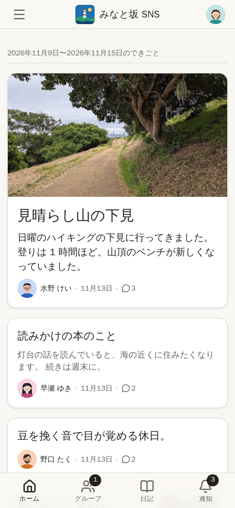

# OpenPNE

[English](README.md)

OpenPNE は、自分たちの SNS サイトを運営するためのオープンソースソフトウェアです。地域、サークル、会社、ファンの集まりなど、ひとつのコミュニティのための場所を、自分で管理するサーバに置けます。誰でも参加できるサイトにも、招待制のサイトにもできます。

<p align="center">
  
  
  
</p>

上の画像に出てくる人と投稿は、すべて架空のものです([docs/images](docs/images/README.md))。

このリポジトリは OpenPNE 4 です。[OpenPNE 3](https://github.com/openpne/OpenPNE3) の後継として、Laravel 13 で作り直しました。

この文書は [README.md](README.md) のうち、OpenPNE の紹介からサイトの運営までを日本語にしたものです。内容が食い違う場合は、英語版が正です。

## サイトでできること

- **メンバー**: プロフィール、フレンド、メッセージ、通知。
- **日記**: 写真、コメント、リアクションを付けられます。誰に見せるかを 1 件ずつ選べます。
- **グループ**: チャットのための「トーク」、じっくり話すための「トピック」、参加を募る「イベント」。
- 短い投稿のための**タイムライン**と、サイトであったことをまとめて見られる**ホーム**。
- **2 つの見た目**: スマホを基準に作った Modern と、OpenPNE 3 のサイトの画面・URL・テーマを引き継ぐ Classic。
- **管理画面**: メンバー、投稿、登録の受け付け方、サイトの見た目。
- **ログイン**: パスワード、2 要素認証、パスキー。
- **日本語と英語**。メンバーごとに選べます。
- **AI クライアント**が [MCP](https://modelcontextprotocol.io) サーバを通して、メンバーとして、またはメンバーが持つ AI アカウントとして読み書きできます。
- **OpenPNE 3 からのアップグレード**。メンバーと、メンバーが書いたものを引き継ぎます([docs/upgrading-from-openpne3.md](docs/upgrading-from-openpne3.md)、英語)。

## 試す

[Docker](https://docs.docker.com/get-started/get-docker/) と Compose があれば、次のコマンドで、手元で試せるサイトが起動します。

```bash
git clone https://github.com/openpne/openpne.git && cd openpne
bin/dev-up                                                           # http://localhost:8080
docker compose exec app php artisan openpne:install                  # テーブルと、新しいサイトの初期データ
docker compose exec app php artisan openpne:admin:create admin       # パスワードを聞かれます。/admin でログイン
docker compose exec app php artisan openpne:member:invite you@example.com
```

最初の `bin/dev-up` には数分かかります。イメージをビルドし、依存パッケージをインストールし、フロントエンドの開発サーバを起動して、サイトが応答するまで待つためです。最後のコマンドを実行すると、登録用のリンクが表示されます。リンクを開いて名前とパスワードを決めると、サイトの最初のメンバーとして登録されます。日記を書いたり、グループを作ったりできます。ほかの人も同じコマンドで招待できます。管理画面の「メンバー招待」からも招待できます。その招待メールは、実際のメールボックスではなく <http://localhost:8025> に届きます。

上のコマンドで起動する構成は、OpenPNE を試すためと、開発するためのものです。データは clone したディレクトリ内の SQLite ファイルに保存され、フロントエンドは開発サーバから配信されます。

## サイトを運営する

実際に運営するサイトでは、`main` ではなくタグの付いたリリース(`v4.0.0-alpha.N`、[Releases](https://github.com/openpne/openpne/releases))を使います。リリースにアーカイブが付いていれば、サーバに Composer や Node.js がなくてもインストールできます。サーバへのインストール方法は [docs/installing.md](docs/installing.md)(英語)にあります。必要なものは、PHP 8.3 以降、SQLite か MySQL、Web サーバ、キューのジョブを実行する手段です。リリースから次のリリースへの更新手順は [docs/updating.md](docs/updating.md)(英語)にあります。

バージョンに `-alpha` が付いている間は、互換性を保つ手段なしに、動作や保存データが変わることがあります。修正は新しいリリースとして公開し、以前の alpha には適用しません。

## そのほか

- 開発の手順: [README.md](README.md#developing)(英語)
- OpenPNE 3 からのアップグレード: [docs/upgrading-from-openpne3.md](docs/upgrading-from-openpne3.md)(英語)
- インストールや更新ができないときの報告と、不具合の報告: [New issue](https://github.com/openpne/openpne/issues/new/choose) のフォーム(項目は英語です。日本語で記入してかまいません)
- 脆弱性を非公開で報告する方法: [SECURITY.md](SECURITY.md)(英語)
- ライセンス: Apache License 2.0([LICENSE](LICENSE))
