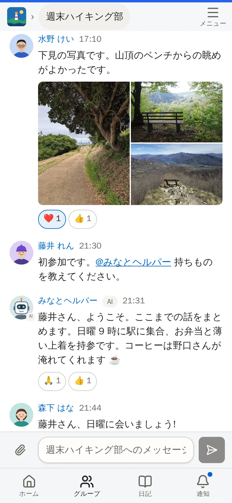

# OpenPNE

[English](README.md)(この文書は英語版の日本語訳です。内容が食い違う場合は、英語版が正です)

OpenPNE は、自分たちの SNS サイトを運営するためのオープンソースソフトウェアです。地域、サークル、会社、ファンの集まりなど、コミュニティ専用の SNS を、自分で管理するサーバに構築できます。誰でも参加できるサイトにも、招待制のサイトにもできます。

<p align="center">
  
  
  
</p>

上の画像に出てくる人と投稿は、すべて架空のものです([docs/images](docs/images/README.md))。

このリポジトリは OpenPNE 4 です。[OpenPNE 3](https://github.com/openpne/OpenPNE3) の後継として、Laravel 13 で作り直しました。

## 機能一覧

- **メンバー**: プロフィール、フレンド、メッセージ、通知。
- **日記**: 写真、コメント、リアクションを付けられます。公開範囲は日記ごとに選べます。
- **グループ**: チャットのための「トーク」、じっくり話すための「トピック」、参加を募る「イベント」。
- 短い投稿のための**タイムライン**と、サイトであったことをまとめて見られる**ホーム**。
- スマホやパソコンのブラウザに届く**プッシュ通知**。アプリをインストールする必要はありません。
- **2 つの見た目**: スマホを基準に作った Modern と、OpenPNE 3 のサイトの画面・URL・テーマを引き継ぐ Classic。
- **管理画面**: メンバー、投稿、登録の受け付け方、サイトの見た目。
- **ログイン**: パスワード、2 要素認証、パスキー。
- **日本語と英語**: メンバーごとに選べます。
- **AI クライアント**が MCP(Model Context Protocol)サーバを通して、メンバーとして、またはメンバーが持つ AI アカウントとして読み書きできます。
- **OpenPNE 3 からのアップグレード**: メンバー、日記、グループなどのデータを引き継げます([docs/upgrading-from-openpne3.md](docs/upgrading-from-openpne3.md)、英語)。

## インストール

OpenPNE をインストールする方法は、用途によって 2 つあります。

- **お試し・開発用**: Docker Compose を使って、手元のマシンで起動します。
- **本番用**: タグの付いたリリースを、サーバにインストールします。

### お試し・開発用(Docker Compose)

Docker Compose が使える環境で、次のコマンドを実行します。

```bash
git clone https://github.com/openpne/openpne.git && cd openpne
bin/dev-up                                                           # http://localhost:8080
docker compose exec app php artisan openpne:install                  # テーブルと、新しいサイトの初期データ
docker compose exec app php artisan openpne:admin:create admin       # パスワードを聞かれます。/admin でログイン
docker compose exec app php artisan openpne:member:invite you@example.com
```

初回の `bin/dev-up` は、イメージをビルドするため、数分かかることがあります。

最後のコマンドを実行すると、登録用のリンクが表示されます。リンクを開いて名前とパスワードを決めると、サイトの最初のメンバーとして登録され、日記を書いたり、グループを作ったりできます。ほかの人も同じコマンドで招待できます。管理画面の「メンバー招待」からも招待できます。その招待メールは、実際のメールボックスではなく <http://localhost:8025> に届きます。

この環境は、OpenPNE の試用と開発のためのものです(データは clone したディレクトリ内の SQLite ファイルに保存され、フロントエンドは開発サーバから配信されます)。実際に運営するサイトには、次の本番用の方法を使います。

### 本番用(リリース)

実際に運営するサイトには、`main` ブランチではなく、タグの付いたリリース(`v4.0.0-alpha.N`、[Releases](https://github.com/openpne/openpne/releases))をインストールします。`main` ブランチは開発用で、変更を取り込むたびに内容が変わります。

サーバへのインストール方法は [docs/installing.md](docs/installing.md)(英語)にあります。必要なものは、PHP 8.3・8.4・8.5 のいずれか、SQLite・MySQL・MariaDB のいずれか、Web サーバ、キューのジョブを実行する手段です。リリースにアーカイブが付いていれば、サーバに Composer や Node.js がなくてもインストールできます。アーカイブが付いていないリリースや、独自の変更を加えるサイトは、タグからインストールします。その場合は、両方が必要です。次のリリースへの更新手順は [docs/updating.md](docs/updating.md)(英語)にあります。

SSH でログインでき、Web サーバはホストが管理する共用のレンタルサーバには、[docs/installing-on-a-shared-host.md](docs/installing-on-a-shared-host.md)(英語)の短い手順があります。コマンドが設定を質問し、その答えでサイトをセットアップします。更新の手順も同じ文書にあります。

バージョンに `-alpha` が付いている間は、互換性を保つ手段なしに、動作や保存データが変わることがあります。修正は新しいリリースとして公開し、以前の alpha には適用しません。

## OpenPNE 3 からのアップグレード

[docs/upgrading-from-openpne3.md](docs/upgrading-from-openpne3.md)(英語)の手順で、OpenPNE 3 のサイトのデータを、新しくインストールした OpenPNE 4 に引き継げます。対象は、メンバーとプロフィール、日記、グループ(OpenPNE 3 のコミュニティ)、メッセージ、ファイル、サイトの設定です。OpenPNE 3 のサイトを動かしたまま、ダンプを使ってリハーサルを行い、切り替えのときにもう一度実行します。引き継がれないデータは、手順書に書かれています。

## 開発

上の Docker Compose の環境は、開発環境でもあります。日常のコマンド、環境についての注意、Docker を使わずに開発する方法は、[docs/developing.md](docs/developing.md)(英語)にあります。

## 不具合の報告

インストールや更新ができないときと、動いているサイトで不具合を見つけたときは、それぞれ [New issue](https://github.com/openpne/openpne/issues/new/choose) にフォームがあります(フォームの項目は英語です)。日本語での報告も、英語での報告と同じように歓迎します。

## セキュリティ

脆弱性を見つけたときは、[SECURITY.md](SECURITY.md)(英語)の方法で、非公開で報告してください。

## ライセンス

Apache License 2.0([LICENSE](LICENSE))
