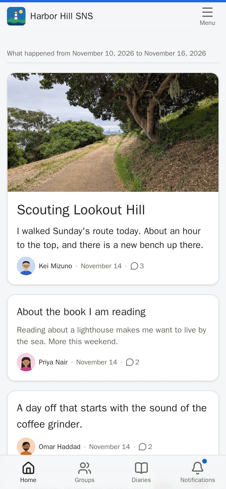
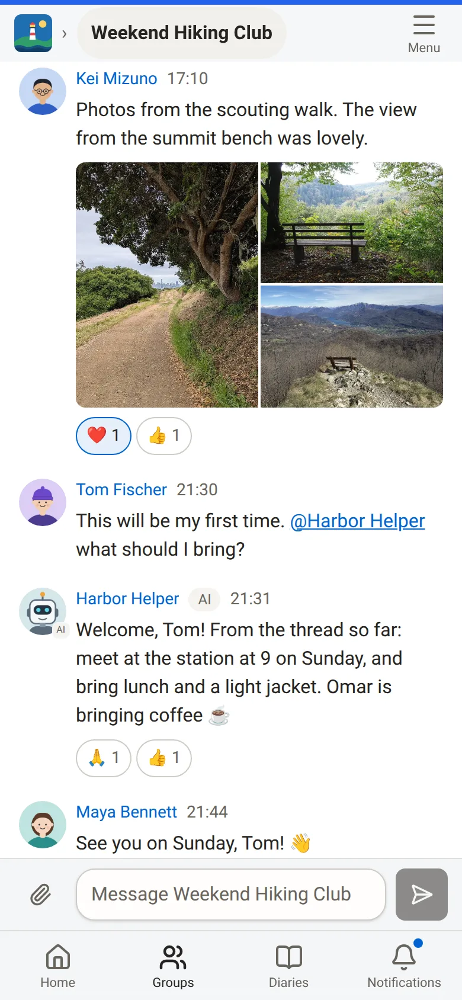

# OpenPNE

[日本語](README.ja.md)

OpenPNE is open-source software for running your own social networking site: a place for one
community — a neighbourhood, a club, a company, a fan base — on a server you control, open to
anyone or by invitation only.

<p align="center">
  
  
  
</p>

The people and posts in these pictures are made up ([docs/images](docs/images/README.md)).

This repository is OpenPNE 4, a rewrite on Laravel 13 that succeeds
[OpenPNE 3](https://github.com/openpne/OpenPNE3).

## Features

- **Members**: profiles, friends, direct messages, notifications.
- **Diaries**: posts with photos, comments and reactions, and a choice of who may read each one.
- **Groups**: a talk room for chat, topics for longer threads, events with sign-up.
- **A timeline** for short posts, and **a home page** that sums up what has happened on the site.
- **Push notifications** to a phone or a desktop browser, with no app to install.
- **Two looks**: Modern, built for phones first, and Classic, which keeps the screens, addresses and
  themes of an OpenPNE 3 site.
- **An admin panel** for members, what they post, who may register and the look of the site.
- **Sign-in** with a password, two-factor codes or passkeys.
- **Japanese and English**, chosen per member.
- **AI clients** can read and post through an MCP (Model Context Protocol) server, as a member or
  as an AI account a member owns.
- **An upgrade from OpenPNE 3** that carries over a site's members, diaries, groups and more
  ([docs/upgrading-from-openpne3.md](docs/upgrading-from-openpne3.md)).

## Installation

There are two ways to install OpenPNE, depending on what it is for:

- **To try it or develop it**: start it on your own machine with Docker Compose.
- **For production**: install a tagged release on a server.

### To try or develop (Docker Compose)

With Docker Compose, run:

```bash
git clone https://github.com/openpne/openpne.git && cd openpne
bin/dev-up                                                           # http://localhost:8080
docker compose exec app php artisan openpne:install                  # the tables and a new site's initial data
docker compose exec app php artisan openpne:admin:invite you@example.com
```

The first `bin/dev-up` can take a few minutes, as it builds an image.

The last command prints a registration link. Open it, choose a name and a password, and you are the
site's first member and its administrator: registering opens the admin panel at `/admin`, and you are
free to write a diary entry or start a group. Invite others with `openpne:member:invite`, or from
"Member invites" in the admin panel, whose mail arrives at <http://localhost:8025> instead of a real
mailbox.

This setup is for trying OpenPNE and for developing it (it keeps its data in a SQLite file in the
checkout and serves the frontend from a development server). A site that serves people uses the
production install below.

### For production (a release)

A site that serves people installs a tagged release (`v4.0.0-alpha.N`, under
[Releases](https://github.com/openpne/openpne/releases)), not the `main` branch. `main` is the
development line and moves with every merged change.

[docs/installing.md](docs/installing.md) sets a release up on a server: PHP 8.3, 8.4 or 8.5, SQLite,
MySQL or MariaDB, a web server, and a way to run queued work. The site needs a host name of its
own, which a subdomain such as `sns.example.com` can be: under a path such as
`https://example.com/sns/`, the Modern pages do not work. Where a release has an archive, installing from
it needs neither Composer nor Node.js on the server. A release without one, or a site that will
carry changes of its own, is installed from its tag, which needs both. Moving from one release to the next is [docs/updating.md](docs/updating.md).

On a shared host, a rental server where you sign in over SSH and the host runs the web server,
[docs/installing-on-a-shared-host.md](docs/installing-on-a-shared-host.md) is the shorter way: a
command asks for the settings and sets the site up, and the guide covers updating there too.

While the version carries `-alpha`, a release may change behaviour or stored data without a
compatibility path, and a fix is published as a new release: an earlier alpha is not patched.

## Upgrading from OpenPNE 3

[docs/upgrading-from-openpne3.md](docs/upgrading-from-openpne3.md) migrates an OpenPNE 3 site's data
into a fresh OpenPNE 4 install: members and their profiles, diaries, groups (OpenPNE 3's
communities), messages, files, and the site's own settings. It is rehearsed against a dump while the
old site keeps serving, then repeated as the cutover. The guide says what is not carried.

## Developing

The Docker Compose setup above is the development setup too. [docs/developing.md](docs/developing.md)
has the day-to-day commands, notes on the setup, and how to develop without Docker.

## Reporting a problem

A site that will not install or update, and a bug in one that runs, each have a form under
[New issue](https://github.com/openpne/openpne/issues/new/choose). A report in Japanese is as welcome
as one in English.

## Security

Found a vulnerability? [SECURITY.md](SECURITY.md) says how to report it privately.

## License

Apache License 2.0 — see [LICENSE](LICENSE).
