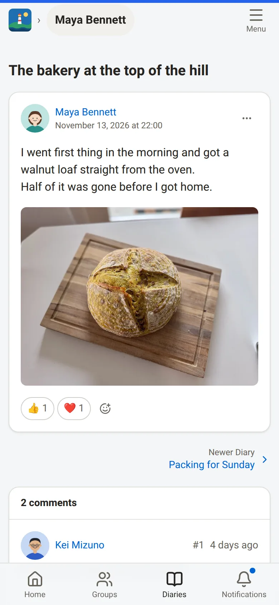

# OpenPNE

[日本語](README.ja.md)

OpenPNE is open-source software for running your own social networking site: a place for one
community — a neighbourhood, a club, a company, a fan base — on a server you control, open to
anyone or by invitation only.

<p align="center">
  
  
  
</p>

The people and posts in these pictures are made up ([docs/images](docs/images/README.md)).

This repository is OpenPNE 4, a rewrite on Laravel 13 that succeeds
[OpenPNE 3](https://github.com/openpne/OpenPNE3).

## What a site has

- **Members**: profiles, friends, direct messages, notifications.
- **Diaries**: posts with photos, comments and reactions, and a choice of who may read each one.
- **Groups**: a talk room for chat, topics for longer threads, events with sign-up.
- **A timeline** for short posts, and **a home page** that sums up what has happened on the site.
- **Two looks**: Modern, built for phones first, and Classic, which keeps the screens, addresses and
  themes of an OpenPNE 3 site.
- **An admin panel** for members, what they post, who may register and the look of the site.
- **Sign-in** with a password, two-factor codes or passkeys.
- **Japanese and English**, chosen per member.
- **AI clients** can read and post through an [MCP](https://modelcontextprotocol.io) server, as a
  member or as an AI account a member owns.
- **An upgrade path** from OpenPNE 3 that carries a site's members and what they wrote
  ([docs/upgrading-from-openpne3.md](docs/upgrading-from-openpne3.md)).

## Try it

With [Docker](https://docs.docker.com/get-started/get-docker/) and Compose, these commands end in a
site to click around in:

```bash
git clone https://github.com/openpne/openpne.git && cd openpne
bin/dev-up                                                           # http://localhost:8080
docker compose exec app php artisan openpne:install                  # the tables and a new site's initial data
docker compose exec app php artisan openpne:admin:create admin       # asks for a password; sign in at /admin
docker compose exec app php artisan openpne:member:invite you@example.com
```

The first `bin/dev-up` takes a few minutes: it builds an image, installs the dependencies, starts a
development server for the frontend, and returns once the site answers. The last command prints a
registration link. Open it, choose a name and a password, and you are the site's first member, free
to write a diary entry or start a group. Invite others the same way, or from "Member invites" in
the admin panel, whose mail arrives at <http://localhost:8025> instead of a real mailbox.

This stack is for trying OpenPNE and for working on it. It keeps its data in a SQLite file in the
checkout and serves the frontend from a development server.

## Running a site

A site that serves people runs a tagged release rather than `main`; see [Releases](#releases).
[docs/installing.md](docs/installing.md) sets one up on a server: PHP 8.3 or later, SQLite or
MySQL, a web server, and a way to run queued work. Moving from one release to the next is
[docs/updating.md](docs/updating.md).

## Developing

`bin/dev-up` is the development stack too. On first start the `app` container runs
`composer install`, creates `.env` with `APP_URL` set to the stack's address, generates `APP_KEY`,
and runs migrations; the `vite` sidecar runs `npm ci` and starts the Vite dev server on `:5173`.
Source is bind-mounted so code changes are reflected without a rebuild.

Day-to-day commands run inside the containers:

```bash
docker compose exec app php artisan test --parallel
docker compose exec app vendor/bin/pint --test    # drop --test to auto-format
docker compose exec vite npm run type-check
```

A change under `resources/js` is checked by the frontend lane, by `i18n:check`
and by PHP tests that read those files, so run them at once before pushing (host
toolchain, as it needs npm and php together; the production build is not part of
it):

```bash
composer test-frontend
```

Notes:

- Containers that write to the source tree run as `OPENPNE_UID:OPENPNE_GID`
  (`bin/dev-up` defaults both to your uid/gid; plain `docker compose` falls
  back to `1000:1000`), so everything they create — `vendor/`,
  `node_modules/`, `storage/`, the SQLite file — stays owned by the host
  user.
- `node_modules/` contains platform-specific binaries, so on macOS avoid
  mixing host `npm` and the Docker path in one checkout: the `vite`
  container reinstalls automatically when the platform changed, but a
  host-side install after that needs a manual `npm ci` too.
- To rebuild frontend assets through Docker, run
  `docker compose run --rm vite npm run build`.
- The stack runs an [imgproxy](https://imgproxy.net) sidecar; set
  `OPENPNE_IMAGE_PROCESSOR=imgproxy` in `.env` to process pictures through it
  instead of GD (`docs/internals/images.md`, "Processing").
- If port `8080` is taken, set `OPENPNE_HTTP_PORT=18080` before
  `bin/dev-up`, and give `APP_URL` in `.env` the same port if an earlier
  start has already created that file. Port `5173` is fixed (Vite always binds it
  inside the container and `public/hot` references that port, so a
  host-side remap would not actually redirect the browser).

### Without Docker

Requires PHP 8.3+, Composer 2.x, and Node.js 26+ on the host:

```bash
composer install
npm install
cp .env.example .env                     # then set APP_URL=http://localhost:8000
php artisan key:generate
touch database/database.sqlite
php artisan openpne:install              # schema + the initial data of a new site
php artisan openpne:admin:create admin   # the first administrator, for /admin
php artisan openpne:member:invite you@example.com   # prints the first member's registration link
php artisan passport:keys  # optional: lets AI clients sign in to the MCP server

php artisan serve         # http://localhost:8000
npm run dev               # Vite dev server on :5173 (HMR)
```

`APP_URL` is what a printed link starts with, so it has to carry the port. Mail goes to the
application log here, and only once `php artisan queue:work` has run.

## Releases

`main` is the development line and moves with every merged change. A site runs a tagged release
(`v4.0.0-alpha.N`, under [Releases](https://github.com/openpne/openpne/releases)): it installs
the release's archive, which needs neither Composer nor Node.js on the server, or checks out the
release's tag rather than `main`, and moves from one release to the next with
[docs/updating.md](docs/updating.md).

While the version carries `-alpha`, a release may change behaviour or stored data without a
compatibility path, and a fix is published as a new release: an earlier alpha is not patched.

## Upgrading from OpenPNE 3

Running an OpenPNE 3 site? [docs/upgrading-from-openpne3.md](docs/upgrading-from-openpne3.md)
migrates its data into a fresh OpenPNE 4 install — rehearsed against a dump while the old site keeps
serving, then repeated as the cutover.

## Security

Found a vulnerability? [SECURITY.md](SECURITY.md) says how to report it privately.

## License

Apache License 2.0 — see [LICENSE](LICENSE).
